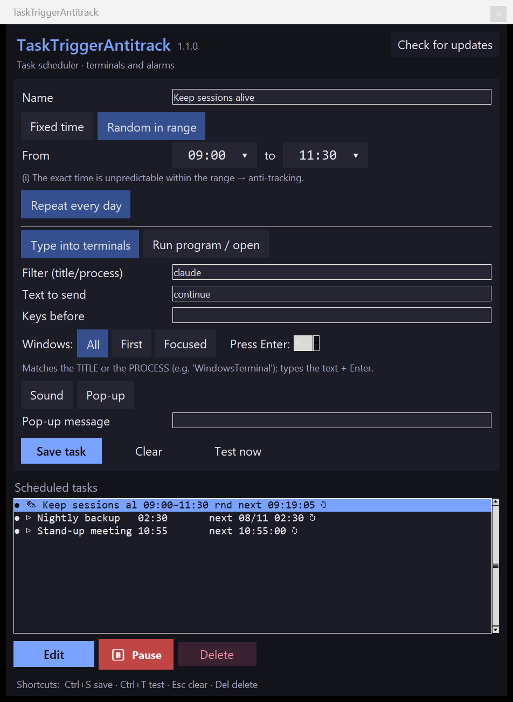

# TaskTriggerAntitrack

[English version](README.md)

<p align="center"></p>

Programador de tareas de escritorio (Python + tkinter, **sin dependencias pip**) que
a una hora dispara una acción. Fusiona dos herramientas:

- **Alarma** — dispara a una hora **aleatoria dentro de un rango**, ejecuta un programa
  o abre un archivo/URL, con sonido y aviso.
- **Continua terminales** — a una hora, escribe un texto + **Enter** en todas las
  terminales abiertas cuyo título case un filtro (reanudar
  [Claude Code](https://claude.com/claude-code) cuando se restablece el límite de uso).

El botón **Buscar actualizaciones** trae de GitHub las versiones nuevas. Es la **única conexión de
red** de la app y solo se hace cuando lo pulsas ([detalles](#buscar-actualizaciones)).

   

## Qué hace cada tarea

Cada tarea de la lista combina **cuándo** se dispara con **qué** hace:

### Cuándo
- **Hora fija** `HH:MM`.
- **Aleatoria en un rango** `[desde, hasta]`: elige un instante al azar dentro de la ventana.
- **Repetir cada día**: al dispararse, se reprograma para el día siguiente (recalculando
  el azar si la hora es aleatoria).

### Qué
- **Escribir en terminales**: busca las ventanas que casen con el *filtro* (por
  defecto `WindowsTerminal`), las enfoca una a una y teclea el *texto* (por defecto
  `continua`) seguido de **Enter**. El filtro busca en el **título** de la ventana y,
  en Windows, también en el **nombre del proceso**: así `WindowsTerminal` encuentra las
  terminales aunque su título cambie. Filtro vacío = todas las ventanas. Opcional: *teclas previas* (p. ej. `esc` o
  `ctrl+c` antes del texto), *nº de Enter* a pulsar (`0` = enviar sin Enter), y a
  *qué ventanas* actuar (todas / solo la primera / solo la que tiene el foco).
- **Ejecutar programa / abrir**: lanza un programa o abre un archivo/URL en su
  aplicación por defecto. Opcional: *argumentos* (estilo línea de comandos),
  *carpeta de trabajo* y *modo de ventana* (normal / minimizado / oculto / elevado
  con UAC).

### Extras
- **Sonido** al disparar.
- **Aviso emergente** con un mensaje.

## Intervalo aleatorio: antitrazabilidad

> La opción de **hora aleatoria en un rango** no es solo comodidad: es una función de
> **antitrazabilidad**.

Cuando una tarea abre siempre una web o ejecuta un programa a la **misma hora exacta**,
ese patrón horario es predecible: cualquiera que observe el tráfico o el sistema puede
anticipar *cuándo* vas a conectarte a un determinado servicio o *cuándo* se va a lanzar
un determinado programa, y correlacionar esa actividad contigo.

Al elegir la hora de disparo **al azar dentro de un rango** (p. ej. "en algún momento
entre las 02:00 y las 06:00"), el momento concreto deja de ser predecible en cada
ejecución. Así:

- No hay una **firma horaria** fija que delate la conexión o el arranque del programa.
- Se **rompe la correlación** entre una hora conocida y la acción, dificultando inferir
  qué web o qué programa se va a usar a partir del reloj.
- Cada día (con *Repetir cada día*) el azar se recalcula, de modo que ni siquiera se
  mantiene estable de una jornada a otra.

Es especialmente útil para la acción **Ejecutar programa / abrir**: programar una
apertura de un servicio a una hora impredecible dentro de una ventana amplia.

## Uso

Clónala con git o descarga el zip de la
[última versión](https://github.com/javimentallab/TaskTriggerAntitrack/releases/latest) y
descomprímelo. Las dos copias se pueden actualizar después con el botón **Buscar
actualizaciones**. Luego arráncala desde su carpeta:

```bash
git clone https://github.com/javimentallab/TaskTriggerAntitrack.git
cd TaskTriggerAntitrack
python tasktriggerantitrack.py
```

En Windows también puedes hacer doble clic en `tasktriggerantitrack.cmd` (abre la ventana sin consola).

1. Rellena **nombre**, elige **hora fija** o **rango**, y el **tipo de acción**.
   Las horas se eligen en un **selector tipo reloj**: pincha la hora en el anillo
   (exterior `0–11`, interior `12–23`) y luego los minutos.
2. **Guardar tarea** (aparece en la lista). **Probar ahora** para verla disparar en el acto.
3. Deja la ventana abierta: cada segundo comprueba y dispara lo que toque.

En la lista: `●` activa / `⏸` pausada · `✎` terminal / `▷` programa · `↻` repite a diario ·
`next HH:MM:SS` el próximo disparo (o `next DD/MM HH:MM` si no es hoy). Selecciona una tarea para editarla, pausarla o eliminarla.

Atajos: `Ctrl+S` guardar · `Ctrl+T` probar · `Esc` limpiar · `Supr` eliminar.

### Arranque y fiabilidad

- **Instancia única**: si ya está abierta, lanzarla otra vez solo trae al frente la
  ventana existente (no duplica disparos).
- **Autoarranque**: con `--min` arranca minimizada; pensado para un acceso directo en
  la carpeta de Inicio de Windows (`shell:startup`) o en el autostart del escritorio.
- Las tareas se guardan de forma **atómica** (no se corrompen si se corta a mitad) y
  una tarea con datos inválidos se desactiva en vez de impedir el arranque. Un
  `alarms.json` ilegible se copia aparte (`alarms.json.corrupto-<fecha>`) con un aviso, y no
  se toca hasta que guardes una tarea. Cualquier fallo queda en `error.log` (con `pythonw`
  no hay consola).

### Buscar actualizaciones

El botón **Buscar actualizaciones** (arriba a la derecha) consulta en GitHub la última versión
publicada. Es la **única conexión a internet** de la app y solo se hace cuando lo pulsas: no
comprueba nada al arrancar ni en segundo plano. Envía una petición HTTPS a `api.github.com` con un
*User-Agent* genérico (`TaskTriggerAntitrack-updater/<versión>`), sin datos tuyos, y solo acepta
respuestas y redirecciones de los dominios de GitHub. Si hay versión nueva, te pregunta antes de
cambiar nada.

- **Clon de git** (un `git clone`): si está limpio y sin commits propios, trae con git la etiqueta
  de esa versión desde el repositorio oficial (`https://github.com/javimentallab/TaskTriggerAntitrack`,
  no el `origin` que tenga configurado) y avanza hasta ella solo con *fast-forward*. Git comprueba lo
  que descarga por sus huellas. Si hay cambios locales o commits propios, o falta git, no toca nada:
  te explica por qué y te ofrece la página de la versión.
- **Otra copia en una carpeta que se puede escribir**: descarga el zip de esa versión, comprueba su
  suma SHA-256 cuando la versión la publica (si no la publica, te lo dice), sustituye los ficheros y
  guarda los anteriores en `.tta-backup-<versión>-<fecha>`.
- **Carpeta que no se puede escribir**: guarda el zip en Descargas y abre la página de la versión.

Nunca toca `alarms.json`, `error.log` ni tu `alarm_sound.wav`. Después de actualizar hay que cerrar
la app y volver a abrirla.

## Idiomas

La interfaz está en castellano, inglés, portugués, francés, alemán, italiano, neerlandés, polaco,
ruso, ucraniano, chino, japonés, coreano, tailandés e hindi. Sigue el idioma del sistema; para elegir
otro, arráncalo con `--lang xx` (p. ej. `--lang de`) o con la variable de entorno `TTA_LANG`. Los
textos están en `tta_lang.py`.

## Requisitos

- **Python 3.8+** con tkinter (incluido de serie en Windows y en la mayoría de distros).
- **Windows**: nada más. El enfoque y tecleo en ventanas usa Win32 vía `ctypes`, y el
  sonido usa `winsound` (ambos de la stdlib).
- **Linux (X11)**: `xdotool` para enfocar/teclear en ventanas, y `aplay`/`paplay` para el
  sonido. (En Wayland el tecleo en ventanas ajenas puede estar restringido.)

## Persistencia

Las tareas se guardan en `alarms.json` junto al script. No se versiona (contiene tu
configuración personal), igual que `error.log` y las copias que deja el botón **Buscar actualizaciones**
(`.tta-backup-*`).

## Seguridad

Escaneo con **Trivy** en cada push (`.github/workflows/trivy.yml`): vulnerabilidades,
secretos y malas configuraciones. **CodeQL** analiza el código y los tests también corren en cada push.

## Contribuir

Consulta [CONTRIBUTING](CONTRIBUTING.md), en inglés. Para avisar en privado de un problema de seguridad, consulta [SECURITY](SECURITY.md).

## Licencia

[MIT](LICENSE)
