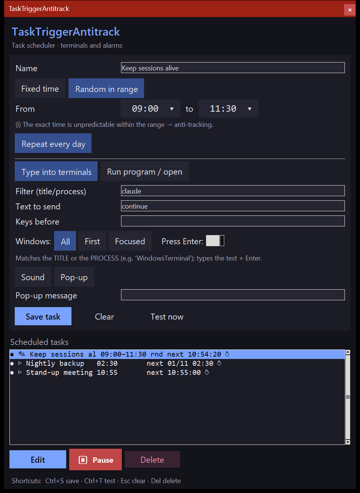

# TaskTriggerAntitrack

[Versión en español](README.es.md)

<p align="center"></p>

Desktop task scheduler (Python + tkinter, **no pip dependencies**) that fires an action
at a given time. It merges two tools:

- **Alarm** — fires at a **random time within a range**, runs a program or opens a
  file/URL, with a sound and a pop-up.
- **Resume terminals** — at a given time, types a text + **Enter** into every open
  terminal whose title matches a filter (to resume
  [Claude Code](https://claude.com/claude-code) when the usage limit resets).

   

## What each task does

Each task in the list combines **when** it fires with **what** it does:

### When
- **Fixed time** `HH:MM`.
- **Random within a range** `[from, to]`: picks a random moment inside the window.
- **Repeat every day**: once it fires, it is rescheduled for the next day (drawing a new
  random time if the time is random).

### What
- **Type into terminals**: finds the windows that match the *filter* (by default
  `WindowsTerminal`), focuses them one by one and types the *text* (by default
  `continua`) followed by **Enter**. The filter looks at the window **title** and, on
  Windows, also at the **process name**: that way `WindowsTerminal` finds the terminals
  even when their title changes. Empty filter = every window. Optional: *keys before*
  (e.g. `esc` or `ctrl+c` before the text), *number of Enters* to press (`0` = send
  without Enter), and *which windows* to act on (all / only the first / only the
  focused one).
- **Run program / open**: launches a program or opens a file/URL in its default
  application. Optional: *arguments* (command-line style), *working folder* and *window
  mode* (normal / minimised / hidden / elevated with UAC).

### Extras
- **Sound** when it fires.
- **Pop-up** with a message.

## Random interval: anti-tracking

> The **random time within a range** option is not just a convenience: it is an
> **anti-tracking** feature.

When a task always opens a website or runs a program at **exactly the same time**, that
schedule is predictable: anyone watching the traffic or the system can anticipate
*when* you are going to connect to a given service or *when* a given program will
start, and link that activity to you.

By picking the firing time **at random within a range** (e.g. "sometime between 02:00
and 06:00"), the exact moment is no longer predictable on each run. So:

- There is no fixed **time signature** giving away the connection or the program start.
- The **link** between a known time and the action is **broken**, making it harder to
  infer from the clock which website or program is going to be used.
- Every day (with *Repeat every day*) the random time is drawn again, so it does not even
  stay the same from one day to the next.

It is especially useful for the **Run program / open** action: scheduling a service to
open at an unpredictable time within a wide window.

## Usage

```bash
python tasktriggerantitrack.py
```

On Windows you can also double-click `tasktriggerantitrack.cmd` (opens the window
without a console).

1. Fill in a **name**, choose a **fixed time** or a **range**, and the **action type**.
   Times are picked on a **clock-style picker**: click the hour on the ring (outer
   `0–11`, inner `12–23`) and then the minutes.
2. **Save task** (it shows up in the list). **Test now** to see it fire straight away.
3. Leave the window open: every second it checks and fires whatever is due.

In the list: `●` active / `⏸` paused · `✎` terminal / `▷` program · `↻` repeats daily ·
`next HH:MM:SS` the next firing (or `next DD/MM HH:MM` if not today). Select a task to
edit, pause or delete it.

### Startup and reliability

- **Single instance**: if it is already open, launching it again just brings the
  existing window to the front (no duplicate firings).
- **Autostart**: `--min` starts it minimised; meant for a shortcut in the Windows
  Startup folder (`shell:startup`) or in the desktop's autostart.
- Tasks are saved **atomically** (they are not corrupted if interrupted halfway) and a
  task with invalid data is disabled instead of stopping the app from starting. Any
  failure goes to `error.log` (with `pythonw` there is no console).

## Languages

The interface is in English, Spanish, Portuguese, French, German, Italian, Dutch, Polish, Russian,
Ukrainian, Chinese, Japanese, Korean, Thai and Hindi. It follows the system's language; to pick one,
start it with `--lang xx` (e.g. `--lang de`) or set the `TTA_LANG` environment variable. The texts live
in `tta_lang.py`.

## Requirements

- **Python 3.8+** with tkinter (included by default on Windows and most distros).
- **Windows**: nothing else. Focusing and typing into windows uses Win32 through
  `ctypes`, and the sound uses `winsound` (both in the standard library).
- **Linux (X11)**: `xdotool` to focus/type into windows, and `aplay`/`paplay` for the
  sound. (On Wayland, typing into other apps' windows may be restricted.)

## Storage

Tasks are saved in `alarms.json` next to the script. It is not versioned (it holds your
personal setup), and neither is `error.log`.

## Security

Scanning with **Trivy** on every push (`.github/workflows/trivy.yml`): vulnerabilities,
secrets and misconfigurations.

## License

[MIT](LICENSE)
